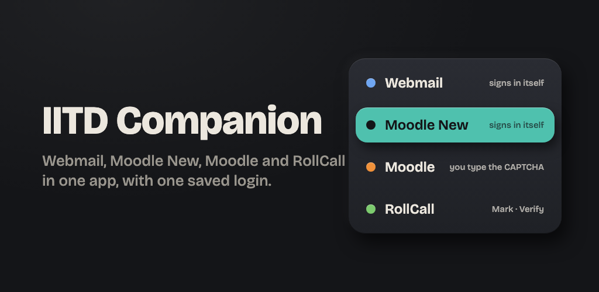
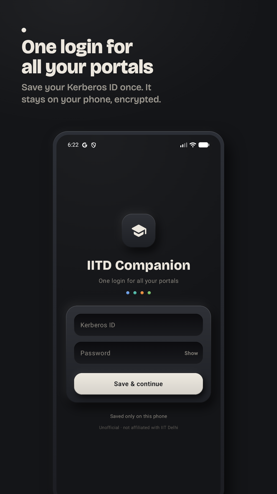
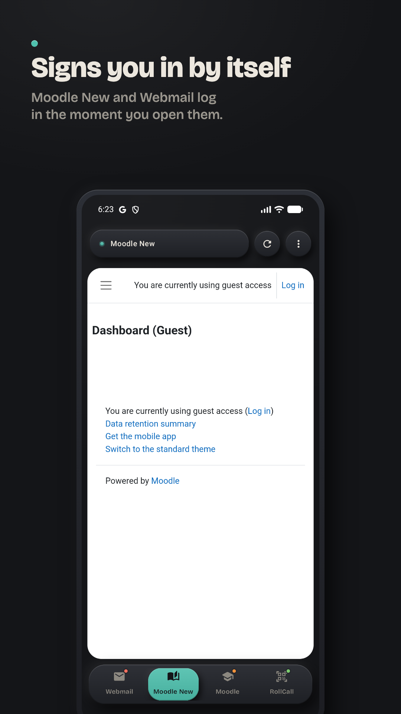
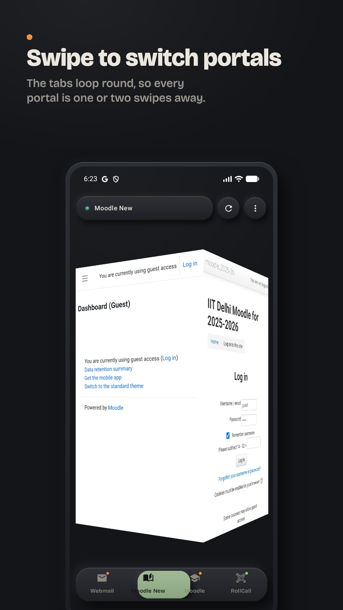
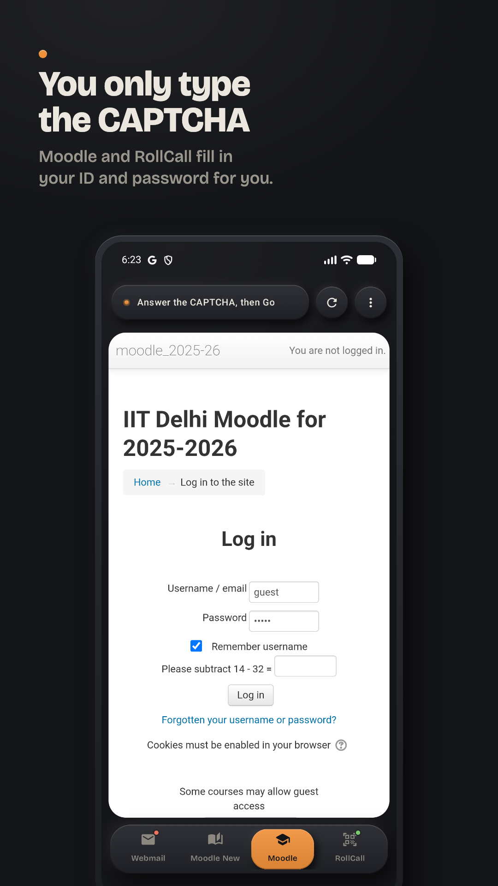
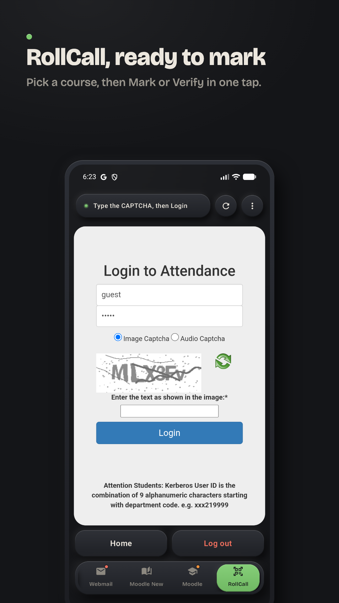

<div align="center">


# IITD Companion

**The IIT Delhi app for Webmail, Moodle, RollCall, eAcademics, exam seat plans and ClassGrid: one sign-in, every portal.**

A free, open-source Android and iPhone app for IIT Delhi students. It signs you in to IIT Delhi's portals with your Kerberos ID and keeps them all one swipe apart.

[Support](https://n06-nitin.github.io/iitd_companion/support.html) · [Privacy policy](https://n06-nitin.github.io/iitd_companion/privacy.html) · [Report a bug](https://github.com/n06-nitin/iitd_companion/issues) · [Built by an IITD student](#about-the-developer)




</div>

## What is IITD Companion?

IITD Companion is an unofficial mobile app that puts IIT Delhi's most-used websites into one place: **Webmail**, **Moodle New**, **Moodle**, **RollCall**, **eAcademics**, **Exam IITD** (exam seat plan) and DevClub's **ClassGrid** timetable. You save your Kerberos ID and password once, and the app fills in each portal's login page for you. Each portal opens in its own tab, and you swipe between them.

It is made by an IIT Delhi student, for IIT Delhi students: [Nitin Singh](#about-the-developer), a third-year student living in Aravali Hostel, under his studio [XLON Labs](https://xlonlabs.com). It is not affiliated with or endorsed by IIT Delhi.

## Screenshots

<p align="center">
  
  
  
  
  
</p>

## Features

- **One login for every portal.** Save your Kerberos ID and password once. The app signs you in to each IIT Delhi portal.
- **Hands-free sign-in to Webmail and Moodle New.** These have no CAPTCHA, so you are signed in without touching anything.
- **Moodle's sum, answered for you.** Moodle's CAPTCHA is a written sum like "Please add 49 + 83". The app answers it and signs you in (Android 1.1.2 and iPhone 1.1.3 onwards).
- **Type only the CAPTCHA on IIT Delhi's sign-in page.** RollCall, eAcademics, Exam IITD and ClassGrid all sign in there. The app fills in your ID and password; you type the image CAPTCHA yourself. The app does not read image CAPTCHAs.
- **RollCall attendance with the QR scanner.** The camera works inside the RollCall tab for marking attendance.
- **eAcademics** and **Exam IITD** open from the ⋮ menu, signed in through the same IIT Delhi OAuth page as RollCall.
- **ClassGrid**, DevClub's timetable, opens from the ⋮ menu on its Plan page. The app presses through DevClub's sign-in to IIT Delhi's, so you only type the CAPTCHA.
- **Swipe between tabs.** Every portal stays loaded, so switching is instant. Tapping the open tab again takes that portal back home.
- **Downloads that land where you expect.** Moodle and Webmail files go to Downloads on Android and to the Files app on iPhone.
- **Native on both platforms.** Kotlin and Jetpack Compose on Android, Swift and SwiftUI on iOS. Not a cross-platform wrapper.

## Supported IIT Delhi portals

| Portal | Address | Sign-in |
|---|---|---|
| Webmail | `webmail.iitd.ac.in` | Automatic |
| Moodle New | `moodlenew.iitd.ac.in` | Automatic |
| Moodle | `moodle.iitd.ac.in` | Automatic (Android 1.1.2+, iPhone 1.1.3+) |
| RollCall | `rollcall.iitd.ac.in` via `oauth.iitd.ac.in` | You type the CAPTCHA |
| eAcademics | `eacademics.iitd.ac.in` via `oauth.iitd.ac.in` | You type the CAPTCHA |
| Exam IITD | `exam.iitd.ac.in` via `oauth.iitd.ac.in` | You type the CAPTCHA |
| ClassGrid (DevClub) | `classgrid.devclub.in` via `auth.devclub.in` and `oauth.iitd.ac.in` | You type the CAPTCHA |

## Privacy and security

- **Your password never leaves your phone** except to be typed into IIT Delhi's own login pages, over HTTPS, on those exact addresses.
- **Encrypted at rest.** On Android, with an AES-256 key in the Android Keystore. On iPhone, in the iOS Keychain, for that device only (never synced to iCloud).
- **No analytics, no ads, no tracking, no developer server.** The app talks only to IIT Delhi, plus DevClub for ClassGrid.
- **Excluded from backups.** Your saved login is not copied to Android backups or restored onto another iPhone.
- **One tap to remove it.** ⋮ menu → *Forget login & sign out* deletes your login and every portal cookie.

The code is open, so you can check every line of this yourself. Full details are in the [privacy policy](https://n06-nitin.github.io/iitd_companion/privacy.html).

## Download

| Platform | Status |
|---|---|
| Android (8.0 and later) | [Get it on Google Play](https://play.google.com/store/apps/details?id=com.xlonlabs.iitdcompanion) |
| iPhone (iOS 17 and later) | App Store: in review, public release coming soon |

Want to try it early? [Open an issue](https://github.com/n06-nitin/iitd_companion/issues) or email [nitin@xlonlabs.com](mailto:nitin@xlonlabs.com).

## Frequently asked questions

### Is IITD Companion an official IIT Delhi app?
No. It is an unofficial, independent app and is not affiliated with or endorsed by IIT Delhi. For problems with the portals themselves, such as your Kerberos account or a course page, contact IIT Delhi's Computer Services Centre.

### Who made IITD Companion?
Nitin Singh, a third-year IIT Delhi student in Aravali Hostel and founder of XLON Labs.

### Is it safe to give the app my Kerberos password?
Your password is encrypted on your phone and is only ever typed into IIT Delhi's own login pages. It is never sent to the developer or anyone else, and the full source code is in this repository.

### Why do I still have to type a CAPTCHA?
RollCall, eAcademics, Exam IITD and ClassGrid sign in through IIT Delhi's sign-in page, which shows a CAPTCHA image. The app fills in your ID and password but leaves the CAPTCHA to you. Moodle's CAPTCHA is a written sum, which the app answers by itself (Android 1.1.2 and iPhone 1.1.3 onwards). Webmail and Moodle New have no CAPTCHA, so they sign you in by themselves.

### Can I mark RollCall attendance with this app?
Yes. Open the RollCall tab and allow camera access when asked. The QR scanner on RollCall's attendance page then works as it does in a browser.

### Where do my Moodle downloads go?
On Android, to your Downloads folder. On iPhone, to the Files app, under *On My iPhone › IITD Companion › Downloads*.

### Is the app free?
Yes. It is free, has no ads, and is open source under the MIT license.

More answers are on the [support page](https://n06-nitin.github.io/iitd_companion/support.html).

## Build from source

The repository has two native apps that share no code.

```
android/   Kotlin + Jetpack Compose, WebView per portal (min SDK 26, target SDK 36)
ios/       Swift + SwiftUI, WKWebView per portal (iOS 17+), project generated with XcodeGen
docs/      Privacy policy and support pages, served on GitHub Pages
```

**Android**

```sh
cd android
./gradlew assembleDebug        # APK in app/build/outputs/apk/debug/
```

Release signing reads `android/keystore.properties`, which is not in git. Debug builds need nothing extra.

**iOS**

```sh
cd ios
xcodegen generate              # brew install xcodegen
open IITDCompanion.xcodeproj
```

## About the developer

IITD Companion is designed and built by **Nitin Singh**, a third-year student at **IIT Delhi** living in **Aravali Hostel**, and founder of **[XLON Labs](https://xlonlabs.com)**. Nitin builds native apps and developer tools focused on privacy and on removing small daily frictions.

- Website: [nitinsingh.life](https://nitinsingh.life)
- Company: [xlonlabs.com](https://xlonlabs.com)
- GitHub: [@n06-nitin](https://github.com/n06-nitin)
- Email: [nitin@xlonlabs.com](mailto:nitin@xlonlabs.com)

## More projects by Nitin Singh

| Project | What it does | Link |
|---|---|---|
| **Postie** | Send files and text between all your own devices: phone, tablet, laptop and browser. LAN first, end-to-end encrypted. | [postie.xlonlabs.com](https://postie.xlonlabs.com) |
| **Serverless** | Scan a QR code and connect peer-to-peer for group chat, images and video, with no server in between. | [serverless.xlonlabs.com](https://serverless.xlonlabs.com) |
| **Nebula** | Turn your knowledge into a hosted MCP server that any AI assistant connects to with one link. | [xlonlabs.com/nebula](https://xlonlabs.com/nebula) |
| **Nitinverse** | Nitin's personal site and playground. | [nitinsingh.life](https://nitinsingh.life) |
| **XLON Labs** | The company home: every project, plus the blog. | [xlonlabs.com](https://xlonlabs.com) |

## License

[MIT](LICENSE) © 2026 Nitin Singh (XLON Labs)

<sub>IITD Companion is not affiliated with, endorsed by or sponsored by the Indian Institute of Technology Delhi. "IIT Delhi" and the portal names belong to their owners and are used only to describe what the app works with.</sub>
